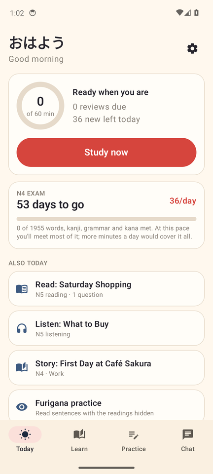
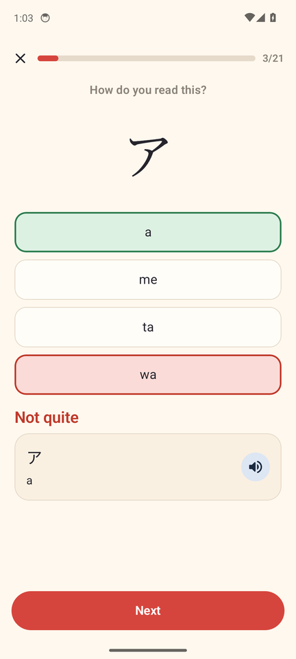
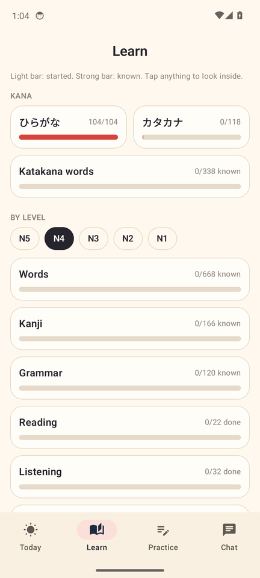
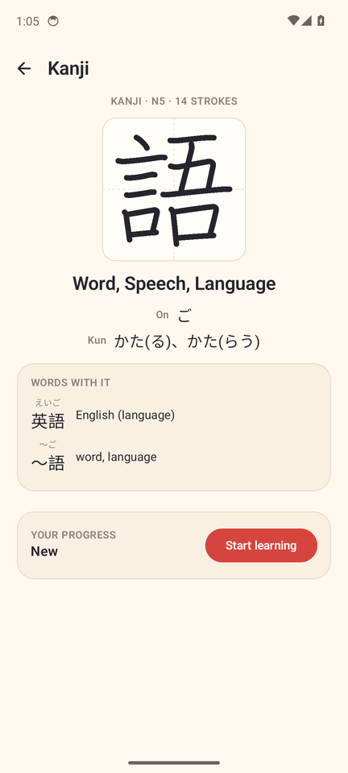
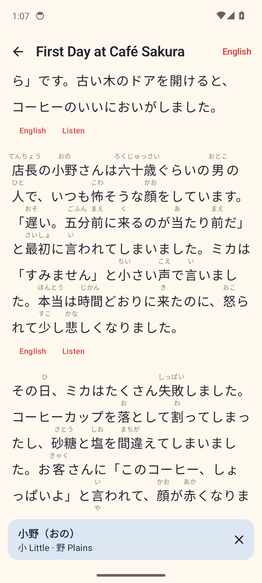
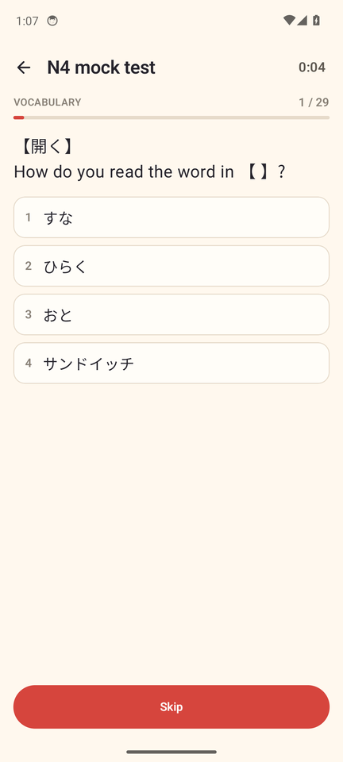

# Just Let Me Pass

**An AI study agent for the JLPT (N5 to N1) on Android.** It plans each day's study around your exam date, runs the reviews with spaced repetition, and uses Claude for chat, explanations of wrong answers and new graded readings.

[](https://github.com/ash1009/JustLetMePass/actions/workflows/build.yml)


| Today | Study | Learn |
|:---:|:---:|:---:|
|  |  |  |
| **Kanji** | **Graded stories** | **Mock tests** |
|  |  |  |

<sub>Screenshots come from the automated UI test run.</sub>

## What it does

- **Plans the day for you.** One **Study now** button mixes reviews that are due with a few new things (katakana first, then words, kanji, grammar and daily phrases). It works out the daily pace from your exam date and time goal, and only reminds you in the evening if you haven't met it.
- **Spaced repetition.** Each right answer moves an item up a stage so it comes back later; a wrong one drops it two stages so it comes back soon. Study time counts only active time, never time the app sat open.
- **Furigana that fades.** Readings over kanji disappear as you learn each kanji or word, and come back with a tap.
- **Graded stories.** 254 stories from N5 to N1, some in connected series, with English per paragraph, audio, questions, and hold-a-word for its meaning.
- **Mock tests** for every level: vocabulary, grammar, reading and listening, with a score and your mistakes.
- **Claude, when you want it.** Chat about anything in Japanese, "Why?" on a wrong answer, and new readings written for your level. It uses your own Claude API key and picks the newest model the key can use. The rest of the app works without it.
- **Audio** from the phone's own Japanese voice: free and offline.

## Content

| | |
|---|---|
| Words | 8,034, with example sentences for N5 to N3 |
| Kanji | 2,211, with stroke order |
| Grammar points | 526 |
| Graded stories | 254 |
| Readings and listening dialogues | 75 and 112 |
| Daily life phrases and katakana words | 332 and 338 |

A Python pipeline builds it all into the app's files:

- `content/raw`: JLPT word lists, kanji data and stroke order from open datasets (credits below).
- `content/written`: example sentences, grammar points, readings, dialogues, stories, phrases and katakana words written for this app.
- `python3 tools/build_content.py` merges them into `app/src/main/assets`.
- `python3 tools/validate.py <file>` checks a file: JSON shape, furigana markup (every kanji has a reading) and quiz answers (the answer is one of the options, no duplicates). CI runs it on every content file.

## How it's built

- **Kotlin** and **Jetpack Compose** (Material 3), one activity
- **Room** for study progress, AlarmManager for the evening reminder
- **Claude API** for chat, explanations and new readings
- Android text-to-speech for audio
- **GitHub Actions**: unit tests, the content check and a build on every push

| Package | What's in it |
|---|---|
| `data` | Content loading, spaced repetition, study planning, progress database, furigana parsing, Claude client, reminder |
| `ui` | Today, Learn, Practice, Chat, study rounds, stories, mock tests, stroke order, settings |

## Build

You need JDK 17 and the Android SDK (API 35).

```bash
./gradlew assembleDebug        # build the app
./gradlew testDebugUnitTest    # run the unit tests
```

Release builds are signed with a key from the environment when one is given (`SIGNING_KEYSTORE`, `SIGNING_STORE_PASSWORD`, `SIGNING_KEY_ALIAS`, `SIGNING_KEY_PASSWORD`), and with the debug key otherwise.

## About

A personal project by [Aashish Biradar](https://aashish-n-biradar.netlify.app), built with the help of an AI coding agent, to pass the JLPT N4 in December 2026.

## Credits

- JLPT word lists: Jonathan Waller's JLPT resources (CC BY), via the Open Anki JLPT decks.
- Kanji data: KANJIDIC by the Electronic Dictionary Research and Development Group (CC BY-SA 4.0), via kanji-data.
- Stroke order: KanjiVG by Ulrich Apel (CC BY-SA 3.0). See `content/raw/kanjivg/README-KanjiVG.md`.

Not affiliated with the Japan Foundation or Japan Educational Exchanges and Services, who run the JLPT.
